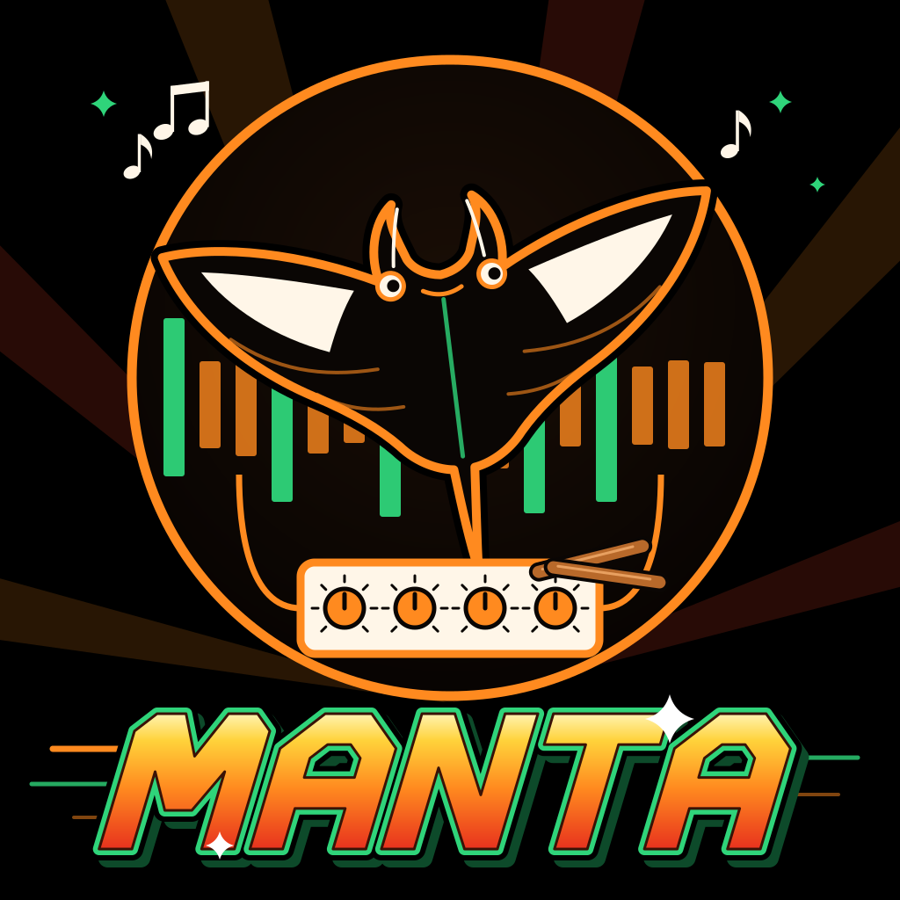
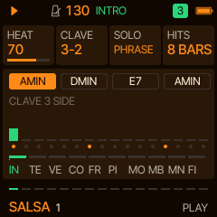
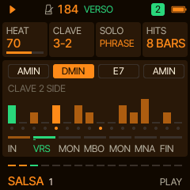
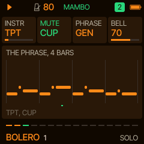
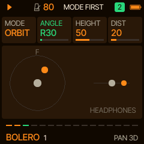
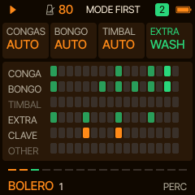

**Patched for FM-1 units with the new chipset.**

**[Quick cheat sheet](docs/CHEATSHEET.md): every control and what it does.**

# Manta

**Generative Latin grooves for the M-VAVE FM-1. Let the band play, ¡tú al solo!** Press PLAY and Manta's band
plays: a sampled percussion section locked to the clave, a montuno on an upright piano, a tumbao bass and a
sampled trumpet and trombone section, from salsa and mambo to bolero and tango. You lead it: fire the band's hits, send the horns into a mambo, and
take the solo trumpet on the keys. Built on [Sill](https://github.com/delirioux/sill),
[Tuna](https://github.com/delirioux/tuna) and [Felucca](docs/FELUCCA.md).

> **Version 0.1, a test build.** The groove, the percussion kit, the upright, the trumpet and trombone and the
> pages are in; the old songs' phrases and the full PAN 3D are next. Built with no warranty.
> [Felucca](https://github.com/hugelton/Felucca)'s installer, or the official V15, takes the FM-1 back.

## Try it, install it

Manta is a test build on `dev` for now; its pages:

- **[Try it in the browser](https://delirioux.github.io/manta/dev/try/)**: the whole firmware, the FM-1's screen and
  sound, compiled to WebAssembly on Felucca's browser emulator (Chrome, Edge or Firefox; the computer keyboard plays
  the keys).
- **[Install it on the FM-1](https://delirioux.github.io/manta/dev/)** from Chrome or Edge on a computer: connect
  the FM-1 with a USB data cable, press Install and allow MIDI when the browser asks. Every run also leaves its
  package in the artifact `manta-firmware`; from a terminal: `python3 tools/fm1_install.py manta-X.Y.fwsc`.

Manta keeps its settings and its eight sets in Felucca's first two song slots: back up anything you made in Felucca
first. Installing firmware is at your own risk.

## Ten things Manta does

1. **A band on the clave**: piano, bass, horns and percussion all phrase with the clave, 3-2 or 2-3 (the CLAVE card).
2. **Ten styles** on two sides: CALIENTE (salsa, mambo, merengue, cumbia, samba) and NOCHE (son, cha-cha, bolero, bossa,
   tango), each with its own tempo, patterns, sounds and percussion.
3. **A real percussion section**: thirty one-shots, congas, bongos, timbales, bells, agogô, claves, woodblock, güiro,
   shakers, cabasa, triangle, toms and a washboard, from CC0 recordings.
4. **Real piano and brass**: a sampled Yamaha upright playing the montuno, and a sampled trumpet and trombone section,
   the trombone an octave under the trumpets.
5. **A song form**: intro, verso, montuno, mambo, montuno, moña and the cierre, round again with a new melody.
6. **BAND HIT** (REC): the whole band hits the clave's figure together on the next bar. Hold it for a descarga: the
   percussion alone, then a timbal roll and the band back on the bar line.
7. **MAMBO** (SEQ): the horn section into its riff from the next bar.
8. **The solo is yours**: the keys play the solo trumpet as you press them, with mutes (cone, cup, harmon, wah: filters over
   the real horn) and its bell's brightness.
9. **PAN 3D** (as [Sardine](https://github.com/delirioux/sardine)'s): the solo placed around your head on headphones,
   duller behind you as the bell turns away, softer far off, orbiting if you like.
10. **The cards**: four knobs, four cards a page, no menus; a new style or song always on the next bar line.

## The four knobs (PLAY)

| | |
| --- | --- |
| **HEAT** | How hot the band plays: the percussion's soft strokes, the quinto's calls, the horns' accents, the dynamics. |
| **CLAVE** | 3-2 or 2-3: which side of the clave the two-bar patterns start on. |
| **SOLO** | OFF, PHRASE (the solo trumpet plays the melody in the verso and improvises in the montuno) or KEYS (only you). |
| **HITS** | Band hits on their own at the end of every 4, 8 or 16 bars of the montuno, or OFF. |

## Ten styles

| CALIENTE | | NOCHE | |
| --- | --- | --- | --- |
| **SALSA** · 184 | montuno, tumbao, trumpet and trombone, timbales and bells | **SON** · 112 | the tres's guajeo, bongos, maracas, a dorian lilt |
| **MAMBO** · 192 | big-band riffs, the mambo bell, 2-3 | **CHA-CHA** · 120 | güiro and bell, the cha-cha-chá bass, charanga violins |
| **MERENGUE** · 152 | fast tambora, the güira's scrape, sax riffs | **BOLERO** · 80 | arpeggios, a harmon-muted trumpet, soft bongos |
| **CUMBIA** · 98 | accordion, guacharaca, the llamador's offbeat | **BOSSA** · 136 | the nylon guitar's bossa, rim clicks, sevenths, a tenor sax |
| **SAMBA** · 102 | surdo, tamborim, agogô, ganzá, the guitar's partido alto | **TANGO** · 118 | marcato piano, bandoneon, no drums at all |

A style brings its own tempo, sounds, key, chord loop, patterns and percussion; your MIX, PAN 3D, ARC and MENU stay.
ALGORITHM picks another song in the same style: a new chord loop, riff and melody, the same each time you come back to
its number.

## Everything

The [manual](docs/MANUAL.md) has every page and card; the [cheat sheet](docs/CHEATSHEET.md) has them on one page.

- **The parts**: PIANO (the montuno: the upright, an electric piano, organ, tres, harp, accordion, bandoneon or
  a nylon guitar that strums), BASS (the tumbao: a baby bass, an upright, FM, sub, slap, slide, round or tuba), HORNS (the section and the
  solo: trumpet and trombone, trumpet, a requinto (the lead guitar), sax, pan pipes, violins, accordion or bandoneon) and PERC (a style's
  percussion set). The percussion, the upright, the trumpet and trombone (TPT+TBN, TPT), the tenor sax and the violin
  section are samples; the rest is Felucca's synthesis.
- **The form** (ARC): INTRO (the percussion, then the piano, then the bass, the horns), VERSO (the melody), MONTUNO
  (the solo improvising, the bongo and timbal bells), MAMBO (the horn section), MONTUNO, MOÑA (the riff with the solo
  over it), CIERRE (the band's hits), then round again. MAMBO off leaves the mambo and the moña out; ARC off plays the
  montuno on and on.
- **The keys** are music only: the solo, an octave over the keys as printed, as you press them (MENU's SNAP puts them
  onto the scale). OCT- and OCT+ move them.
- **MIDI out**: PIANO on channel 1, BASS on 2, HORNS on 3, the percussion on 10 with General MIDI notes.

## Live workflows

- **The descarga build-up**: start a style with ARC off, hold REC for a bar or two: the percussion alone. Let go, the
  timbal rolls, the band comes in on the bar line.
- **Leading the band**: in the montuno, tap REC on the last bar of a phrase for a cierre on the clave; tap SEQ to send
  the horns into the mambo, again to take them out.
- **Your solo**: SOLO on KEYS, LFO for the SOLO page, MUTE on HARMON or WAH, and play over the montuno; LFO again for
  PAN 3D, MODE on ORBIT, and the trumpet walks round you on headphones.
- **A tour**: PRESETS from SALSA to MERENGUE to CUMBIA, each on the next bar line, the CLAVE and HEAT as you go.

## Credits

Manta is by delirioux and Claude. The percussion is from the [Versilian Community Sample
Library](https://github.com/sgossner/VCSL) (CC0), and so is the upright; and so is the tenor sax; the trumpet, the trombone and the violins
from [VSCO 2 CE](https://github.com/sgossner/VSCO-2-CE) (CC0); the rest is Manta's, built on
[Sill](https://github.com/delirioux/sill), [Tuna](https://github.com/delirioux/tuna) and Felucca by Leo Kuroshita
(Hügelton Instruments). See [CREDITS.md](CREDITS.md) and [LICENSING.md](LICENSING.md). GPL-3.0-only.
