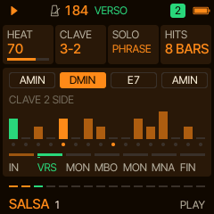
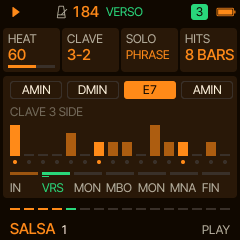
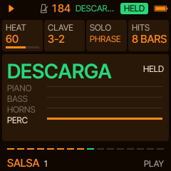
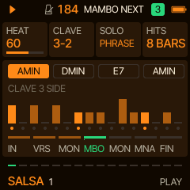
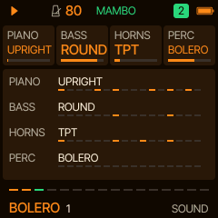
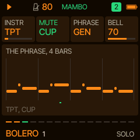
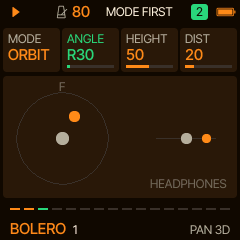
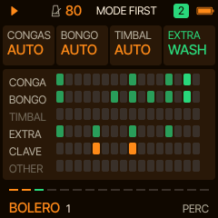

# Manta manual

Manta 0.1. Every page, every card. Four parts play: **PIANO** (the montuno), **BASS** (the tumbao), **HORNS** (the
section, the solo trumpet and whatever you play on the keys) and **PERC** (the style's percussion set, on the clave).
Knob 1 to 4 turn the four cards on the screen. A page's button pressed again goes to its second page where it has one.

## Playing

PLAY starts with the intro (with ARC on) and stops. PRESETS opens the list of the twelve styles while you turn,
CALIENTE on the left, NOCHE on the right; the chosen one comes in on the next bar line, NEXT in the header until it
does. ALGORITHM picks a new song in the same style on the next bar: its number seeds the chord loop, the riffs, the
melody and the sounds, so a song always comes back the same. SELECT is the tempo, MASTER the volume.

The header shows the section playing (INTRO, TEMA, VERSO, CORTE, FRASE, PIANO, MONTUNO, MAMBO, MONA, CIERRE) and, on the right, a badge: the clave's side
(3/2 or 2/3, as the bar playing falls) or HELD while a descarga is held. The footer's sixteen dashes are the way
through the section; under them the style and the song's number, on every page.

**REC is BAND HIT.** Tap it: on the next bar the whole band hits the clave's figure together, a cierre, and drops
back into the groove. Hold it: a descarga, the percussion alone (the screen says so, and HELD) until you let go,
then a timbal roll over the last beat and the band back on the bar line. REC lights while a hit or a descarga is on.

**SEQ is MAMBO.** The horn section goes into the mambo's riff from the next bar line, over the montuno; again to take
it out. SEQ lights while the mambo plays. With ARC on the form brings the mambo in on its own as well.

**The keys** play the solo, on the HORNS sound with the SOLO page's mute and bell, an octave over the keys as printed,
live, as you press them: an off note is yours to play. MENU's **SNAP** (hold HOME, KNOB 3) snaps them to the scale
instead. While you hold one, the written solo makes way. OCT- and OCT+ move the keys' octave. The keys' LEDs glow on
the notes of the chord playing. The keys never change a setting.

## The clave

Every two-bar pattern in Manta, the piano's, the bass's, the horns' and every drum's, is written against the clave,
and CLAVE (PLAY, KNOB 2) says which bar holds its three strokes: **3-2** starts on the three side, **2-3** on the two
side. Turning it shifts the band by a bar, not the clave by a beat, so everything stays locked. MAMBO and CHA-CHA play
2-3; the rest 3-2.

## The form

With ARC on, a song goes:

| Section | Bars | What plays |
| --- | --- | --- |
| **INTRO** (IN) | 4, 8 when fast | The groove: the piano's broken montuno (and the guitar beside it), the percussion with its maracas and woodblock, the bass from the second bar. No horns. |
| **TEMA** (TE) | 8 | The groove with the solo's theme on top, syncopated, twice; its last note the tonic, high, held, with vibrato. |
| **VERSO** (VE) | 8 or 16 | Where a singer would sing: a solo, the trumpet's in some songs and rounds, the piano's in others (the melody in octaves over its left hand, the horns resting). |
| **CORTE** (CO) | 1 | The band stops; the soloist plays a bar alone, a run up into the band's return. |
| **FRASE** (FR) | 4 | A phrase of the trumpet's, improvised, over the groove. |
| **PIANO** (PI) | 8 | The piano's montuno solo: broken thirds up and down the scale on syncopated sixteenths, the left hand's roots; the percussion and the bass go on, the horns and the guitar rest. |
| **MONTUNO** (MO) | 8 or 16 | The bongo's bell and the timbal's bell. Call and response, four bars each: the horn section plays the coro's refrain (where a son's singers would answer), then the solo improvises (or you, on the keys). HITS fire here. |
| **MAMBO** (MB) | 8 | The horn section's mambo riff, louder; the solo rests. |
| **MOÑA** (MN) | 8 | The horns' riff with the solo over it, the band at its hottest. |
| **CIERRE** (FI) | 4 | The band's hits on the clave, then round again from the tema with a new melody. |

MAMBO off on the ARC page leaves the mambo and the moña out. With ARC off the montuno plays on
and on, and SEQ and REC are yours to shape it.

## The pages

| Page (button) | Cards |
| --- | --- |
| **PLAY** (HOME) | **HEAT** how hot the band plays: the ghost strokes, the quinto's calls, the accents and the dynamics. **CLAVE** 3-2 or 2-3. **SOLO** OFF, PHRASE (the band's solo trumpet plays the melody and improvises) or KEYS (only you play it). **HITS** OFF, or band hits on their own at the end of every 4, 8 or 16 bars of the montuno. The panel: the chord loop, the bar as it plays with the clave's strokes over it, and the form with the section playing. |
| **SOUND** (FX) | **PIANO**: UPRIGHT (sampled), EPIANO, ORGAN, TRES, HARP, ACCORD (accordion), BANDO (bandoneon), GUITAR (a nylon guitar: it strums, picks and arpeggiates, each style its own way). With the TRES or the GUITAR the upright plays beside them (on the PERC track). **BASS**: BABY (the baby bass), UPRIGHT (a sampled double bass, plucked), FM BASS, SUB, SLAP, SLIDE, ROUND, TUBA. **HORNS**: TPT+TBN (sampled: the trumpets, the trombone an octave under them), TPT (sampled: the trumpet alone), REQUINT (the requinto, the bolero trio's lead guitar: its riffs in thirds), SAX (a sampled tenor), PANPIPE (the Andes' pan pipes), VIOLINS (a sampled section), ACCORD, BANDO. **PERC**: a style's percussion set, any style's. Each style has its own sound a part and three more; song 1 plays its own, the other songs pick from the four (a card turned by hand holds until the next song). |
| **SOLO** (LFO) | **INSTR** the solo's sound (the HORNS sound: the section and the solo share the track). **MUTE** AUTO (the default: the section's chords open, and each solo turn takes the next mute, CONE, CUP, HARMON, WAH and round), or one for the whole HORNS track, the section and the solo alike: OPEN, CONE (the straight mute), CUP, HARMON or WAH (the harmon's stem opening and closing on each note); filters over the open horn, so they cost no flash (on TPT+TBN and TPT a real mute's filter; on the other sounds the tone darker). BOLERO's horns sit back in its mix. **PHRASE** where the solo's lines come from: GEN, made in the style; TRAD and MIX, phrases from traditional songs, are coming and play GEN for now. **BELL** how bright the bell sounds. |
| **PAN 3D** (LFO again) | As [Sardine](https://github.com/delirioux/sardine)'s, for the solo, on headphones. **MODE** OFF, FIXED (where ANGLE puts it), ORBIT (round your head, a bar a step) or STEP (a new place each phrase). **ANGLE** FRONT, R10 to R170, BACK, L170 to L10. **HEIGHT** up or down. **DIST** near or far. Behind you the bell turns away and the trumpet goes duller; far off it goes softer. The cards are grey while MODE is OFF. In 0.1 PAN 3D is the bell's tone, the level and the pan; Sardine's binaural filters are next. |
| **PERC** (EDIT) | **CONGAS** OFF, AUTO (the style's), TUMBAO, MARCHA, BOLERO. **BONGO** OFF, AUTO, MARTIL (the martillo), BELL (the bongo bell, in the montuno). **TIMBAL** OFF, AUTO, SHELL (the cascara on the shell), BELL. **EXTRA** OFF, AUTO, GUIRO, SHAKER, CABASA, WASH (the washboard: one scrape a bar, now and then a tap when it is hot). The panel draws the two bars of the clave and the lanes playing. |
| **KEY** (SCL) | **KEY** the root. **SCALE** MIN, MAJ, DOR (dorian), HARM (harmonic minor). **CHORDS** a chord loop. **BARS** a chord lasts 1, 2 or 4 bars. |
| **GROOVE** (ARP) | **SWING** on the sixteenths (salsa plays it straight, cumbia and bossa a little swung). **PIANO** the montuno's pattern, 1 to 4 of the style's own (the GUITAR has two a style: 1 and 3 the first, 2 and 4 the second). **BASS** the tumbao's pattern, 1 to 4. **FILLS** every 8, 4 or 2 bars, or none: the timbal's and the conga's fills into the next phrase. |
| **MIX** (GLO) | the four parts' levels. |
| **SPACE** (GLO again) | **ROOM** a small, dry room: Manta is meant to be punchy. **PLATE** more of the room on the horns and the piano. **WARMTH** a softer top, as an old record. **WIDTH** the stereo spread of the percussion and the piano. |
| **ARC** (ENV) | **ARC** on: the song has its form (above); off: the montuno on and on. **VERSO** 8 or 16 bars. **MON** the montuno, 8 or 16 bars. **MAMBO** the mambo and the moña in the form or not. |
| **SETS** (SAVE) | Eight sets: the whole song, style and all. **SET** picks one, **LOAD** and **STORE** turned right do it, **CLEAR** turned right three times empties it. |
| **MENU** (hold HOME) | **COLOR** the palette: HAVANA by default (mango and palm), and Felucca's. **LOOK** FLAT or LINE. **SNAP** the keys: OFF, as you press them (the default), or ON, onto the scale. The panel: the version and the CPU, the audio's load. |

A style sets its tempo, sounds, key, chord loop, clave, groove, percussion, space and the solo's mute; MIX, PAN 3D,
ARC and MENU stay yours.

## The percussion

Thirty one-shots, recorded (the [Versilian Community Sample Library](https://github.com/sgossner/VCSL), CC0) where a
good recording was free, made where it was not: the quinto, the conga's open and muted tones and the tumba; the
bongo's high, low and muted; the timbales' high and low heads (a rope-snare stroke and a tuned head), their rim and
the paila; the mambo bell, the bongo bell and a muted bell; the agogô's two bells; the claves; a woodblock; the güiro
short and long; the shaker forward and back; the cabasa; the triangle open and muted; two toms; a kick; the
washboard's scrape and tap. Each style plays its own set of them: the surdo and tamborim of the samba on the toms,
the llamador and guacharaca of the cumbia on the conga and the güiro, the tango none at all.

## MIDI out

PIANO on channel 1, BASS on 2, HORNS (and the keys) on 3, the percussion on 10 with General MIDI notes (the congas,
bongos, timbales, cowbell, agogô, claves, woodblock, güiro, maracas, cabasa and triangle each on their own; the
washboard's scrape on the short güiro's, its tap on the claves').

## Saving

The settings save themselves two seconds after the last change while stopped, never while playing (writing the
flash would stall the audio). They live in Felucca's first song slot, the sets in its second.
